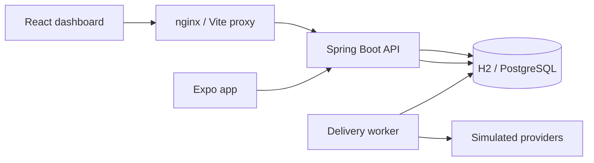

# Engineering notes

This is the part of the submission I would read first. It covers what I built, what I deliberately did not build, how it behaves under failure, where it stops scaling, and where AI helped.

## 1. Scope

The assessment asks for the full-stack track (Parts 0, 1, 3, 4, 5) with the mobile app recommended. I built all of it and added the DevOps track (Part 6): a React operations dashboard, a Spring Boot campaign service, an Expo monitoring app, a Word system design document, Docker Compose, and CI.

I optimised for **a small system that can be explained end to end**, not for maximum feature count. The brief is explicit that senior candidates are judged on architecture, DDD/EDA, reliability, and scale. At internship level I chose to demonstrate those ideas with working code and honest limits rather than with frameworks I could not operate.

### Deliberate cuts

| Not built | Why | What I did instead |
| --- | --- | --- |
| JPA / Hibernate | The queries are the interesting part; ORM magic hides batch and locking behaviour | `JdbcTemplate`, explicit SQL, `batchUpdate` |
| Kafka / RabbitMQ | A broker would add a second failure domain and another container for a single-node demo | Durable database queue, claimed in batches |
| Redis | One process can hold a token bucket correctly | In-process token bucket, with the multi-instance fix documented |
| WebSockets | The brief explicitly allows polling | React Query `refetchInterval` |
| Auth server / OIDC | Out of scope and easy to fake badly | Bearer tenant fixtures, resolved by a filter |
| UI kit / chart library | A dashboard does not need 300 kB of components | Hand-written CSS and a 40-line bar chart |
| React Navigation | Two tabs do not need a navigation graph | Local tab state |
| Real email/SMS/push | The brief says simulate and record | Provider simulator with latency and failure rate |

## 2. Architecture

A **modular monolith** with three deployables:

- `api` — Spring Boot 4 / Java 21. Packages are split by bounded context: `tenant`, `campaign`, `common`. Campaign intake, rules, delivery, and read models live together because they share one transaction boundary and one database.
- `web` — React 19 + TypeScript. Talks only to `/api`, polls for operational freshness, and keeps no domain state of its own.
- `mobile` — Expo / React Native. Read-only monitoring, offline cache, push preview, alerts, biometrics.



Why a monolith:

- The assessment is one bounded system. Splitting intake, rules, and delivery into services would introduce network failures without a scaling need.
- The worker and API share the job schema. A shared database is the simplest correct queue for this size.
- The package boundaries are real: `campaign` does not reach into `tenant` internals; `tenant` knows nothing about campaigns.

Why Spring Boot:

- The brief prefers Java Spring Boot. I used Spring MVC, Spring JDBC, Flyway, and the scheduler — no JPA, no Lombok, no MapStruct.
- Java 21 virtual threads let the worker block on provider latency without a thread pool sized to the provider.
- H2 keeps the demo one command. The SQL is deliberately close to PostgreSQL; the system design document describes the production topology.

## 3. Data model and tenancy

```
tenants 1──* campaigns 1──* recipients
                    │
                    └──* notification_jobs 1──* delivery_attempts
tenants 1──* suppressions
```

- Every tenant-owned table carries `tenant_id`; every query includes it. The bearer token resolves to a `Tenant` request attribute, and the controller passes `tenant.id()` into the repository. A campaign belonging to another tenant is a `404`, not a `403`, so the API does not confirm existence.
- `recipients` uses `(campaign_id, recipient_ref)` as its primary key. That removes a generated-key round trip during import and makes the job foreign key natural.
- `notification_jobs` has `UNIQUE (campaign_id, recipient_ref)`. A repeated upload cannot create a second job for the same recipient in the same campaign.
- Indexes cover the two hot paths: `(tenant_id, status, next_attempt_at)` for claiming and `(campaign_id, status)` for detail counts.
- Flyway owns the schema. There is no manual SQL step.

The integration test `CampaignApiTest.isolatesCampaignsByTenant` creates a Northstar campaign and asserts Meridian gets `404` for the detail and an empty list.

## 4. Campaign intake

The API accepts `multipart/form-data`. Spring writes the part to disk (`file-size-threshold=0`) so a large upload does not sit on the heap. `CsvRecipientParser`:

- reads the header and requires `recipientId,email,phone`;
- iterates records with Commons CSV rather than reading the file into a list;
- validates the channel-specific destination (email for `EMAIL`, E.164 for `SMS`), the optional IANA timezone, and the recipient id;
- rejects the **whole** campaign on the first bad row, with the row number;
- inserts recipients and jobs in batches of 500 inside one transaction.

Tradeoff: one transaction gives all-or-nothing semantics, but it holds a database connection for the length of the parse. That is fine for the 50,000-row benchmark below. At 2 million rows I would stage the file in object storage, return `202` immediately, and import in a separate job with a progress record. The current code is the small correct version, not the 10-million-row version.

`Idempotency-Key` is optional. A repeated key returns the existing campaign and its recipient count. The unique constraint `(tenant_id, idempotency_key)` is the real guard; the service check is only there to return a clean response.

Quota is checked twice: before parsing (fail fast if the tenant is already over) and after parsing (roll back if this campaign would cross the monthly limit). The count is jobs created in the current UTC month and includes skipped jobs, because the tenant is billed for accepted work.

## 5. Delivery pipeline

State machine:

```
PENDING ──claim──▶ PROCESSING ──success──▶ SENT
   ▲                    │
   │                    ├──failure, attempts < 3──▶ PENDING (next_attempt_at)
   │                    └──failure, attempts = 3──▶ FAILED
   └──retry endpoint─── FAILED

PENDING ──rule skip──▶ SKIPPED
```

**Claiming.** The worker polls every 500 ms, promotes due `SCHEDULED` campaigns to `RUNNING`, selects up to 25 due jobs, and flips them to `PROCESSING` with a conditional update. This is safe for one worker. Multiple workers would need `SELECT ... FOR UPDATE SKIP LOCKED` or a lease column; that is in the production section.

**Concurrency and back-pressure.** A `Semaphore` bounds in-flight jobs to 16, and the worker only claims as many jobs as there are free permits. The database is the durable queue; there is no unbounded in-memory queue to overflow. The API returns `202` as soon as the transaction commits.

**Rate limiting.** One token bucket per channel, capacity 100, refill 100/60 per second. A worker that cannot get a token within 5 seconds puts the job back with `next_attempt_at = now + 1s` and does **not** increment the attempt count, because a rate limit is not a provider failure.

**Retries.** Three attempts total. Delay is `min(60, 2^(attempt-1))` seconds plus up to 200 ms of jitter: 1 s, 2 s, 4 s. The jitter prevents a burst of jobs from retrying in lockstep. Terminal failures keep `last_error` for the error breakdown and manual retry.

**Rules.** The order is deliberate:

1. **Suppression** — recipient opted out for this channel → `SKIPPED`, no provider call.
2. **Deduplication** — same tenant, channel, recipient, and template marked `SENT` in the last five minutes → `SKIPPED`.
3. **Quiet hours** — SMS/push, non-transactional, local time 22:00–08:00 → delayed until 08:00 in the recipient's zone (tenant zone as fallback).
4. Otherwise send.

Suppression runs before quiet hours so an opted-out recipient is not delayed until morning. Transactional SMS/push bypass quiet hours, as the brief requires. The rule engine is a static function over a `Job` plus two booleans; the database lookups live in `RuleRepository`, which keeps the time logic unit-testable without Spring.

**Campaign completion.** Status is derived, not written by the hot path. A single `UPDATE ... WHERE NOT EXISTS (open jobs)` flips `RUNNING` to `COMPLETED` when at least one job was `SENT` or `SKIPPED`, otherwise `FAILED`. This makes crash recovery idempotent: if the process dies, the next worker run can still finish the campaign.

**Idempotency and the honest gap.** The unique job constraint prevents duplicate jobs. The status transition prevents two workers in the same process from sending the same job. But the provider call and the `markSent` write are not atomic: if the JVM dies after the provider accepts the message and before the database commit, a retry can duplicate the send. Production would pass a provider idempotency key derived from the job id, or use an outbox + provider receipt. I did not pretend this is exactly-once.

## 6. How it scales

The brief's target is 10 million notifications/day.

| Quantity | Value |
| --- | --- |
| Average | 10,000,000 / 86,400 = **115.7 msg/s** |
| 3× peak | **347 msg/s** |
| Provider limit | 100/min/channel = **1.67 msg/s per channel credential** |
| Shards needed at peak, all on one channel | 347 / 1.67 ≈ **208** |
| Shards needed at peak, split evenly across 3 channels | 347 / 3 / 1.67 ≈ **69 per channel** |
| Shards needed at average, one channel | 115.7 / 1.67 ≈ **69** |

The important result is that **worker concurrency is not the bottleneck; the provider quota is.** Sixteen virtual threads with 125 ms average latency could theoretically push ~128 sends/s. The token bucket allows 1.67/s per channel. One campaign to 10 million recipients on one credential would take about **69 days**. To hit 10 million/day you need roughly 70 provider credentials or a contracted limit per channel, plus a scheduler that partitions recipients across them. That is a commercial and routing problem before it is a code problem.

Other numbers:

- **Writes:** 10M jobs + roughly 12M attempts + status updates ≈ 25–30M writes/day, about **290/s average and 870/s at 3× peak**. PostgreSQL handles that with batched updates and daily partitions; H2 does not.
- **Storage:** roughly 150–200 bytes per job plus attempts, on the order of **2–3 GB/day**; 30-day retention is ~60–90 GB before compression.
- **CSV:** 10M rows at ~50 bytes is ~500 MB. The measured import rate below would put that at roughly **10 minutes** by linear extrapolation, but the single transaction would not survive that size; production uses an async staging import.
- **Queue depth:** at 1.67/s per channel, a 100,000-recipient campaign is a ~17-hour drain on one credential. The retry queue and backlog are visible in the detail view, which is why the UI exposes `pending` and `retryQueue` rather than only a percentage.

### Measured import benchmark

Local Windows machine, Java 21, H2 file database, warm JVM, `scripts/load.mjs`. The script schedules seven days out so the worker does not send anything; this measures the full multipart upload, validation, and job creation path.

| Rows | Wall clock | Rows/s |
| --- | --- | --- |
| 10,000 | 1.92 s | **5,208** |
| 50,000 | 2.90 s | **17,227** |

The 50k run is faster per row because JIT and connection warm-up are amortised. These are import numbers, not delivery numbers. They are useful because they show the batch insert and streaming path are not the first bottleneck.

## 7. Failure scenarios

| Scenario | Behaviour | Gap |
| --- | --- | --- |
| Provider is slow | 50–200 ms simulated latency; virtual threads wait without exhausting platform threads | No timeout around the provider call |
| Provider is down | 20% failures, three attempts, then `FAILED` with an error code; manual retry available | No circuit breaker, so a hard outage still burns retries |
| Retry storm | Exponential backoff + jitter + per-channel bucket caps the rate | No global backoff or dead-letter topic |
| Process dies mid-send | Job stays `PROCESSING`; campaign stays `RUNNING` | No lease/heartbeat reaper; documented as the top production fix |
| Duplicate create request | `Idempotency-Key` returns the existing campaign; unique constraint is the backstop | Reusing a key with different content returns the old campaign |
| Duplicate send | `(campaign_id, recipient_ref)` unique; conditional status update | Provider-call/DB gap is at-least-once |
| Bad CSV | Whole campaign rejected with the row number; transaction rolls back | No partial import / resume |
| Tenant leak attempt | Filter rejects a missing/invalid token; repository always scopes by tenant | Demo tokens are not a real auth system |
| Database unavailable | API returns `500`; worker stops polling | No retry/backoff around the datasource |

## 8. Known limitations

1. **Single worker process.** Two instances would each hold a 100/min bucket and could exceed the provider limit. The fix is a Redis token bucket or a per-channel scheduler.
2. **Stuck `PROCESSING` jobs.** A crash between claim and terminal update leaves a job in flight forever. Production needs a lease timestamp, a visibility timeout, and a reaper.
3. **At-least-once provider call.** Explained above.
4. **Deduplication race.** Two workers processing identical messages for different campaigns can both pass the five-minute check before either writes `SENT`. The unique constraint is per campaign, not global. A production dedupe store with a conditional insert would close this.
5. **H2.** File database, no partitioning, no concurrent multi-process access. It is a demo choice, not a production choice.
6. **One import transaction.** Good to 50k, not to 2M.
7. **No event bus / outbox.** Campaign status is derived from jobs. That is reliable and simple, but there is no `CampaignCreated`/`NotificationSent` stream for other services. The brief mentions EDA and the outbox pattern; I chose not to fake a broker in a single-node demo.
8. **Demo auth.** Tokens are seeded fixtures and `/session` exposes them. Real auth, RBAC, and token rotation are out of scope.
9. **Polling.** Four seconds on the list, three on detail. A websocket would be smoother; polling is explicitly allowed and much easier to operate.
10. **Mobile tenant is fixed** to Northstar's demo token. There is no mobile login or tenant switcher.
11. **Metrics cover the last hour** and are aggregated in SQL. Long-running campaigns need a rollup table.
12. **No PII encryption at rest.** Logs are PII-free (no email, phone, or body), but the database stores destinations in plaintext.

## 9. What I would change in production

1. **PostgreSQL** with daily partitions on `notification_jobs` and `delivery_attempts`, Flyway migrations, and a retention job that drops or archives old partitions.
2. **Object storage for CSV** (S3/GCS), an `imports` table, and an async import worker. The API returns `202` with an import id; the UI polls progress. This removes the long transaction and the upload size limit.
3. **A real queue** (SQS or Kafka) with an outbox table. The API commits the campaign and outbox row together; a relay publishes. Consumers keep the same idempotent job key.
4. **Redis token bucket** shared by all workers, plus a per-provider-account routing layer to spread traffic across the 70+ credentials the math requires.
5. **Leases and a reaper.** `claimed_at`, `lease_expires_at`, `SELECT ... FOR UPDATE SKIP LOCKED`, and a scheduled job that re-queues expired leases.
6. **Circuit breaker** (Resilience4j) per provider, with a half-open probe and a dead-letter path.
7. **Provider idempotency keys** derived from `notificationId`, and a provider receipt table, to move from at-least-once to effectively-once.
8. **OIDC/JWT**, tenant roles, per-tenant rate limits, audit logs, and secrets from a manager.
9. **OpenTelemetry** traces and Prometheus metrics: throughput, failure rate, retry rate, queue depth, p95 processing latency, provider latency, and token-bucket wait time.
10. **Blue/green or canary** deployment, with a load test in CI and a synthetic canary campaign in production.

## 10. Testing

`./mvnw test` runs 20 tests:

- `CsvRecipientParserTest` — valid email rows, optional timezone, missing email, non-E.164 phone, missing headers, short rows.
- `RulesTest` — suppression, dedupe, quiet hours at 23:00 Kuala Lumpur, next 08:00, transactional bypass, email exemption.
- `TokenBucketTest` — burst, refill, timeout.
- `BackoffTest` — 1/2/4 s growth, 60 s cap, jitter bounds.
- `TenantRepositoryTest` — seeded tenants and tokens.
- `CampaignApiTest` — create/list/detail, tenant isolation, idempotency, invalid CSV, and a full worker drain that finishes a campaign.

Manual verification: `curl` against `/session`, `/campaigns`, `/campaigns/{id}`; the 10k/50k import benchmark; `npm run lint`, `npm run build`, `npx tsc --noEmit` for the clients. Docker Compose is validated in CI on GitHub's runners; Docker Desktop is not available on this machine, so I did not claim a local container run.

Not tested: the random provider's distribution, Expo on a physical device, biometric hardware behaviour, and browser-level E2E. Those are the next tests I would add (Playwright for web, Detox/Maestro for mobile, a deterministic provider profile for delivery).

## 11. AI assistance

The brief asks for this explicitly, so it is not buried.

I used an AI coding agent as a pair programmer. It generated:

- the Spring Boot, Vite, and Expo project scaffolds;
- first drafts of the JdbcTemplate repositories, controllers, and DTOs;
- unit and integration test cases;
- first drafts of this document, the README, and the system design outline.

I set the scope, chose the architecture, reviewed every file, and ran the tests and benchmarks. During verification I found and fixed three AI-introduced problems: `minute` is a reserved word in H2, so the metrics alias became `bucket`; short CSV rows with a missing optional `timezone` threw instead of being treated as blank; and Spring Boot 4 moved `@AutoConfigureMockMvc` to a new package. The design decisions I would defend in an interview are the modular monolith, the database-backed queue, the rule ordering, the single-transaction import tradeoff, and the decision to show the provider quota as the real scaling ceiling rather than claiming the worker can reach 10M/day.

If I had more time, the first thing I would add is the lease/reaper for `PROCESSING` jobs, because that is the one failure the current system cannot recover from without manual intervention.
